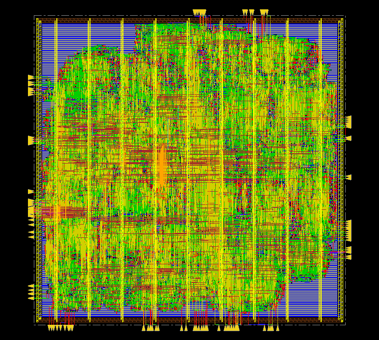

# Tensor Core — RTL to GDS in FreePDK45

One tensor-core sub-partition from my research design, taken through a complete ASIC flow: logic synthesis in Synopsys Design Compiler, place-and-route in Cadence Innovus, and sign-off timing.

The research design is a scaled-down NVIDIA-style GPU on a Virtex-7 FPGA (VC707): 24 SMs, each with four int16 tensor-core sub-partitions (1,536 MACs in total). On the FPGA every MAC maps to a DSP48E1 slice. Here the same RTL is built from standard cells in the FreePDK45 / OSU `gscl45nm` library.



*Routed layout (Innovus): about 375 µm × 375 µm, metal9/metal10 power ring, metal10 power stripes every 40 µm, I/O pins on all four sides.*

## Results

| | |
|---|---|
| Sign-off frequency | **400 MHz** (2.5 ns), the same clock the FPGA build closes at |
| Setup WNS / violations | **+0.045 ns / 0** (post-route, OCV) |
| Hold WNS / violations | **+0.229 ns / 0** |
| DRC / connectivity | **0 / 0** |
| Standard-cell area | 94,400 µm² (excluding fillers); 81,211 µm² after synthesis |
| Die area | 0.141 mm², core density 74.9% |
| Flip-flops | 2,893 |
| Power | 98.4 mW at 400 MHz, about 15.4 pJ/MAC (vectorless estimate, 20% toggle rate) |

Machine-readable versions: [`results/pnr_signoff.csv`](results/pnr_signoff.csv) and [`results/synthesis_sweep.csv`](results/synthesis_sweep.csv).

## The block

`tensor_core` is a 2 × 8 output-stationary MAC array (16 MACs):

- Each k-step, two A values (one per row) and eight B values (one per column) arrive. Cell (r, c) computes `P[r][c] += A[r] * B[c]` with a 16 × 16 signed multiply and a 48-bit accumulator.
- `mac_cell` is a register → multiply → accumulate pipeline (A/B registers, product register, accumulator), the structure a DSP48E1 implements on the FPGA.
- When a block finishes, all 16 accumulators are copied into a 48-bit readout shift chain in one cycle. The accumulators are then free for the next block, and results stream out one per cycle.

RTL: [`rtl/tensor_core.v`](rtl/tensor_core.v), [`rtl/mac_cell.v`](rtl/mac_cell.v).

## Flow

```
RTL ─► Design Compiler ─► netlist + SDC ─► Innovus ─────────────────────────────► GDS
       compile_ultra                       floorplan → power plan → place_opt
       clock sweep 2.5–0.8 ns              → clock_opt_design (CTS) → route
                                           → post-route opt (setup, hold)
                                           → DRC / connectivity → sign-off timing
```

| Step | Script | What it does |
|---|---|---|
| 1 | [`scripts/syn_tensor_core.tcl`](scripts/syn_tensor_core.tcl) | Synthesis with clock, I/O delay, drive and load constraints; writes netlist, SDC and reports |
| 2 | [`scripts/pnr_tensor_core.tcl`](scripts/pnr_tensor_core.tcl) | Import, MMMC setup, floorplan, power ring/stripes/rails, `place_opt_design` |
| 3 | [`scripts/pnr_post_place.tcl`](scripts/pnr_post_place.tcl) | CTS, routing, post-route setup/hold optimization, fillers, DRC, connectivity, power, SPEF/netlist/SDF/GDS (sourced automatically by step 2) |
| 4 | [`scripts/pnr_fix_setup.tcl`](scripts/pnr_fix_setup.tcl) | Extra high-effort post-route optimization pass from the routed checkpoint |
| 5 | [`scripts/pnr_signoff.tcl`](scripts/pnr_signoff.tcl) | Sign-off timing with post-CTS clock uncertainty |

[`run_flow.csh`](run_flow.csh) runs all five in order.

## Synthesis frequency sweep

Design Compiler, typical corner, 0.1 ns clock uncertainty, 20% I/O delay, no wire-load model.

| Period | Frequency | Slack | Cell area | vs. 400 MHz |
|---|---|---|---|---|
| 2.5 ns | 400 MHz | +0.02 | 81,211 µm² | — |
| 2.0 ns | 500 MHz | 0.00 | 83,917 µm² | +3.3% |
| 1.8 ns | 556 MHz | 0.00 | 84,773 µm² | +4.4% |
| 1.6 ns | 625 MHz | +0.01 | 85,904 µm² | +5.8% |
| 1.4 ns | 714 MHz | 0.00 | 86,804 µm² | +6.9% |
| 1.2 ns | 833 MHz | 0.00 | 97,846 µm² | +20.5% |
| 1.0 ns | 1 GHz | −0.09 | 102,609 µm² | +26.3% |
| 0.8 ns | 1.25 GHz | −0.29 | 105,474 µm² | +29.9% |

- **At 2.5 ns** the critical path is the 48-bit accumulator (`p_r → p_r`). DC meets timing with a ripple-carry structure, the smallest adder that fits.
- **At 1.4 ns** the critical path moves to the single-cycle 16 × 16 multiplier (`a_r → m_r`). That multiplier sets the frequency limit, around 1.1 ns (~900 MHz) in synthesis.
- **Area knee.** Going from 400 to 714 MHz costs only 6.9% area. Going from 714 to 833 MHz costs another 12.7%, because the whole multiplier has to be rebuilt as a faster, larger structure.

## Engineering notes

1. **False max-capacitance violations from the library.** Seven `gscl45nm` library pins are characterized with `max_capacitance : 0`. Any load on those pins becomes a violation (5,205 nets), and DC kept inserting buffers trying to fix them. Max-transition violations were zero throughout, so the zero values are a characterization defect. They are removed in memory in DC and from a local `.lib` copy for Innovus. Result: synthesis area went from 84,458 to 81,211 µm² (−3.8%).
2. **Hold after synthesis.** DC reported 681 hold violations (worst −0.02 ns) on flop-to-flop paths such as the readout shift chain, where clk→Q is shorter than the 0.1 ns uncertainty. Hold was deliberately left to P&R. After CTS, Innovus fixed it with real clock skew (final hold WNS +0.229 ns).
3. **CTS command in Innovus 25.1.** `place_opt_design` produces a PODv2 database that the legacy `ccopt_design` rejects (IMPCCOPT-2440), so the flow uses `clock_opt_design`. Post-route timing also requires OCV analysis mode (IMPOPT-7027 otherwise).
4. **Power-ring DRC.** With a 1 µm ring-to-core offset, stripe vias at the core edge landed 0.6 µm from the metal9 ring (rule: 0.8 µm), producing 20 spacing violations. A 2 µm offset clears them.
5. **Synthesis margin.** After the floorplan change the multiplier path closed at −0.005 ns, and an extra high-effort optimization pass recovered only 3 ps. Root cause: DC left the path just 0.02 ns of slack at the P&R target, with nothing to absorb wire delay. The fix for future runs is to synthesize roughly 10% tighter than the P&R target.
6. **Post-CTS clock uncertainty.** Before CTS, the 0.1 ns uncertainty stands in for jitter plus skew. After CTS the real skew is already in every path, so sign-off keeps only the jitter part (0.05 ns). Both results are reported: −0.005 ns at 0.10 ns and +0.045 ns at 0.05 ns.

### Clock tree and power breakdown (first P&R iteration)

- Clock tree: 432 `CLKBUF1` + 4 inverters, 3–5 levels, 2,893 sinks. Insertion delay 0.242–0.375 ns, skew 0.133 ns including useful-skew cells inserted by optimization, worst clock slew 0.098 ns, zero clock-tree DRVs.
- Power: sequential 28%, combinational 48%, clock tree 24%. The clock-tree share is what motivates clock gating in the next iteration.

## Repository layout

```
tensor/
├── README.md
├── run_flow.csh             # runs steps 1–5
├── rtl/                     # tensor_core.v, mac_cell.v
├── scripts/                 # DC and Innovus Tcl
├── results/                 # sweep and sign-off numbers (CSV)
└── images/                  # layout screenshot
```

## Running it

The scripts were run on USC Viterbi Linux servers with Design Compiler Y-2026.03, Innovus 25.1 and the FreePDK45 OSU library under `/tools/PDK/NCSU45PDK/FreePDK45/osu_soc/lib/files`. Library paths and tool setup files are site-specific.

```
cd tensor
tcsh run_flow.csh                    # or run the steps one by one:

setenv PERIOD 2.5
dc_shell -f scripts/syn_tensor_core.tcl | tee dc_2.5.log
mkdir -p pnr/tensor_core
innovus -no_gui -overwrite -log pnr/tensor_core/innovus        -files scripts/pnr_tensor_core.tcl
innovus -no_gui -overwrite -log pnr/tensor_core/innovus_fix    -files scripts/pnr_fix_setup.tcl
innovus -no_gui -overwrite -log pnr/tensor_core/innovus_signoff -files scripts/pnr_signoff.tcl
```

## Next

- Pipeline the 16 × 16 multiplier into two stages (with retiming) and narrow the accumulator from 48 to 41 bits, which is all `|P| < 2^40` needs. Re-run the sweep and compare PPA.
- Clock-gate the accumulators and measure power with simulation activity (VCD) instead of a vectorless estimate.
- Self-checking SystemVerilog testbench with assertions, checked against the Python golden model.
- Scale up to a full SM: four tensor cores, operand buffers, and two asynchronous clock domains with CDC constraints.
